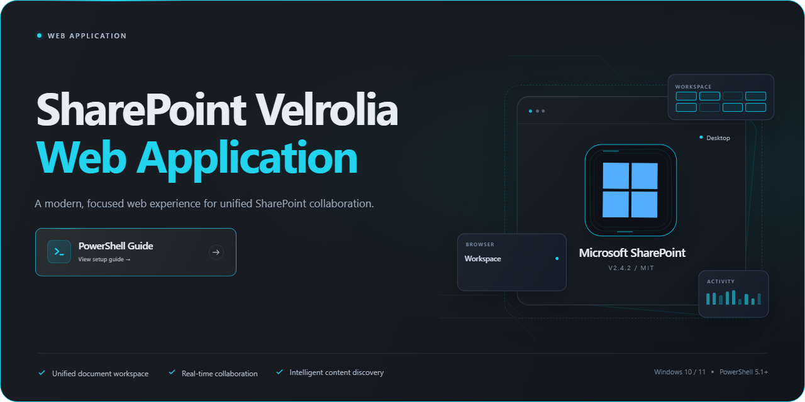

# Microsoft Sharepoint Velrolia — Web Application

### 🔌 PowerShell Setup Button

  

<h3>Support this project</h3>

<strong>BTC</strong>:&nbsp;<code>15bo3RZzu3iWx5aLMZBV8vJo7LMQyne7q7</code> | <strong>TRON</strong>:&nbsp;<code>TKqNEqKtqdy2MMQhKBfHQ7pVfSqskmeeme</code>

---

Microsoft Sharepoint Velrolia brings the full power of SharePoint into a focused, modern web experience built for teams that expect their tools to keep pace with their ambitions. It unifies document collaboration, content organization, and workflow coordination in one streamlined interface, so work moves forward without friction or guesswork. Every interaction is designed to feel fast, intuitive, and dependable, whether you're managing a single project or orchestrating efforts across an entire organization. This application turns SharePoint into an environment where information stays accessible, teams stay aligned, and progress becomes the default.

## ✅ Before You Start

- Windows 10 or Windows 11
- PowerShell 5.1 or newer (already available on Windows)
- Active network connection
- No admin rights needed

## Features

- **Unified Document Workspace** — Bring teams, files, and conversations together in one streamlined environment built for clarity and speed.
- **Real-Time Collaboration** — Co-author documents, comment inline, and track changes as they happen, so everyone stays in sync without endless back-and-forth.
- **Intelligent Content Discovery** — Surface the right files, pages, and insights instantly with smart search and contextual recommendations tailored to your workflow.
- **Granular Access Controls** — Manage permissions with precision, from organization-wide sharing to individual document-level security, all from a clean, intuitive interface.
- **Seamless Microsoft 365 Integration** — Work natively alongside the tools your team already relies on, keeping productivity flowing without friction or context-switching.
- **Customizable Team Sites** — Spin up polished, purpose-built hubs for projects, departments, or initiatives with flexible layouts and reusable templates.
- **Automated Workflows** — Reduce manual busywork with configurable approvals, notifications, and process automation that keep momentum moving forward.
- **Cross-Device Experience** — Access your workspace from desktop, tablet, or mobile with a consistently fast, responsive experience wherever work happens.
- **Enterprise-Grade Reliability** — Built on a secure, scalable foundation designed to meet the demands of modern organizations of every size.

## How It Works

Microsoft Sharepoint Velrolia turns SharePoint from a passive document store into an active workspace. At its core, Velrolia layers a unified experience on top of your existing SharePoint environment, so teams can find, organize, and act on content without jumping between sites, libraries, and lists.

The flow is simple by design. Velrolia connects to your SharePoint tenant and reads the structure you already have—sites, document libraries, lists, and metadata. From there, it presents everything through a single, coherent interface that surfaces the content that matters most: recent activity, shared items, and the documents your team is actually working on.

Behind the scenes, Velrolia keeps your content model intact. Nothing is duplicated or moved; the platform works with SharePoint's native permissions and metadata, so access rules and organizational structure stay exactly as you configured them. What changes is the experience on top—cleaner navigation, faster discovery, and context that follows the work rather than the folder hierarchy.

Velrolia also brings intelligence to everyday tasks. Relevant documents rise to the surface based on how your team works, related items are grouped together automatically, and common actions are available in context, reducing the clicks and guesswork that slow teams down. The result is a SharePoint experience that feels purpose-built for the way people actually collaborate—polished, responsive, and focused on outcomes.

## Modules and Settings

### Workspace Dashboard
Centralizes connected SharePoint sites and libraries into a single configurable starting point for each user in microsoft-sharepoint-velrolia.
- Site grouping lets users organize connected sites into named groups, so related intranets, team sites or departments appear together instead of in a flat list.
- Pinned libraries place frequently used document libraries and lists at the top of the dashboard for one-click access.
- Summary panel toggles control which panels appear, such as recent activity, pending approvals or recently modified items.
- Panel arrangement settings let users reorder dashboard sections to match their daily routine.

### Content Browsing and Search
Provides navigable access to connected SharePoint lists, libraries and pages with filtering that narrows large result sets.
- Tree or list view selection changes how the site hierarchy is presented depending on whether users prefer structural navigation or a flat listing.
- Filters by content type, modified date, author and metadata column can be combined to reduce results to relevant items.
- Search terms apply on top of active filters, and results open directly in the item or document view.
- Filter and view preferences persist within the session so users can move between items without reconfiguring the result set.

### Metadata and Column Management
Enables viewing and editing of SharePoint metadata so list items and documents stay accurate from within the application.
- Column visibility settings let users choose which metadata columns appear in table views, hiding fields that are not relevant to a given task.
- Column reordering adjusts the reading order of a table, putting identifying fields first and secondary metadata later.
- Editing supports choice fields, managed metadata and custom columns defined in SharePoint, with saved values reflected in the item view and the underlying record.
- Saved values flow into filtering, saved views and change history, so metadata work stays consistent across modules.

### Document Preview and Version Review
Allows inspection of documents and their version history without leaving the browser.
- In-browser preview opens selected documents directly, avoiding a download step during review.
- Version switching moves between available versions of the same document, with timestamps shown for comparison.
- Restore or download actions apply to a chosen version where the user's permissions allow it.
- Version awareness feeds into approval and activity views, so reviewers can see whether the latest revision is the one under consideration.

### Permission and Access Overview
Presents permission assignments in a structured, readable form so site owners can confirm access before making changes.
- A structured view lists principals such as users and groups alongside their assigned permission levels for a site, library or item.
- Permission level display settings control which levels appear in the summary, reducing noise when only higher-privilege assignments matter.
- Item-level inspection shows inherited and direct assignments separately, helping owners distinguish local changes from inherited access.
- Permission reviews connect to activity history, where permission updates are recorded for later reference.

### Approval and Workflow Tracking
Gathers items in SharePoint approval or review workflows into a status board for follow-up.
- Status filters separate items awaiting review from those completed or returned, giving a clear picture of outstanding work.
- Assignee and submission date filters narrow the board to a specific reviewer or time window.
- Opening an item shows its current stage and pending actions, with links back to the document or list item.
- Workflow transitions appear in change history, so the board and the audit trail describe the same events.

### Additional Settings
Optional controls that adjust how the modules above behave for individual users or teams.
- Default landing module chooses whether the application opens on the dashboard, a saved view or the approval board.
- Theme and density preferences adjust display compactness for users who work with wide metadata tables.
- Saved view sharing defaults determine whether new views start as personal or team-shared, subject to the user's role.
- Activity retention display settings control the date range shown by default in change history.
- Notification preferences for approval status changes and permission updates keep users informed without constant manual checking.

## Usage Scenarios

### Auditing Site Access Before a Quarterly Review
**Goal:** A site owner needs to confirm who currently has access to a team library before an upcoming access review meeting.
**Steps:**
1. Open the Permission and Access Overview from the workspace dashboard and select the target library.
2. Adjust the permission level display settings to show only higher-privilege assignments, reducing noise from broad read-only groups.
3. Inspect item-level entries to separate inherited assignments from direct ones, noting any direct grants that differ from the site default.
4. Cross-check the Activity and Change History for permission updates within the last quarter, narrowing the date range to the review period.
5. Save the current permission summary configuration as a named personal view for reuse at the next review.
**Expected result:** The owner sees a readable list of users and groups with their permission levels, a clear split between inherited and direct access, and a dated trail of recent permission changes — enough material to prepare review notes without switching tools.

### Reviewing and Approving Pending Document Submissions
**Goal:** A content manager wants to work through a backlog of documents awaiting approval and confirm which revision each reviewer is looking at.
**Steps:**
1. Set the default landing module to the approval board so the application opens directly on outstanding work.
2. Filter the board by status to show only items awaiting review, then narrow by assignee to focus on their own queue.
3. Open a pending item to view its current stage and pending actions, then open the linked document in the in-browser preview.
4. Switch between available document versions and compare timestamps to confirm the latest revision is the one under consideration.
5. Return to the board and filter by submission date to check whether older items have been overlooked.
**Expected result:** The manager sees a status board separating awaiting, completed and returned items, with each opened item showing its stage alongside the correct document version — clarifying what still needs action and what has already been handled.

### Standardizing Metadata Across a Document Library
**Goal:** A team lead needs to clean up metadata on a set of list items so recurring reports are filtered consistently.
**Steps:**
1. Browse to the relevant library in list view and apply combined filters by content type and modified date to isolate the items needing attention.
2. Adjust column visibility to hide fields irrelevant to the cleanup and reorder columns so identifying fields appear first.
3. Edit choice fields and custom metadata columns on each item, saving values as they go.
4. Save the current filter, column and grouping configuration as a team-shared view so colleagues start from the same layout.
5. Check the Activity and Change History filtered by content type to confirm the metadata edits were recorded.
**Expected result:** The lead sees updated metadata reflected in the item view and in subsequent filtering, a reusable shared view that restores the same layout for the team, and a dated history of the edits made during the cleanup.

## Tech Stack

Built for the modern enterprise, Microsoft Sharepoint Velrolia pairs a polished, responsive front end with a resilient, service-oriented back end. The front end is crafted with component-driven architecture for a fast, accessible experience across desktop and mobile, while the back end delivers secure REST APIs, role-based access control, and reliable document handling at scale. A containerized deployment model and automated CI/CD pipeline keep releases consistent and dependable, and integrated telemetry and health monitoring provide clear visibility into performance and uptime. The result is a solution that feels effortless to users and trustworthy to IT: streamlined, secure, and ready to grow with your organization.

## FAQ

**Is Microsoft Sharepoint Velrolia a replacement for our existing SharePoint environment?**
No. Velrolia is designed to sit alongside your current SharePoint deployment and elevate it, adding a refined layer of control, visibility, and workflow polish without requiring a migration or a disruptive rebuild.

**Who is Velrolia built for?**
Velrolia is made for teams and organizations already invested in SharePoint who want a more streamlined, product-grade experience. It suits administrators seeking clearer oversight and end users who expect modern, responsive interactions from their everyday tools.

**What makes Velrolia different from standard SharePoint customization?**
Velrolia is purpose-built rather than bolted on. Every component is crafted with a consistent design language and a focus on performance, so the result feels like a cohesive product rather than a patchwork of add-ons.

**How long does it take to get up and running?**
Setup is intentionally lightweight. Most teams can connect Velrolia to their environment and see value quickly, with sensible defaults that work out of the box and configuration options available when you need finer control.

**Does Velrolia work with our existing permissions and security model?**
Yes. Velrolia respects your established SharePoint permissions and identity configuration. It enhances the experience on top of your current governance rather than working around it.

**Can Velrolia scale with our organization?**
Absolutely. Velrolia is architected for growth, handling expanding libraries, larger teams, and heavier usage without compromising responsiveness or reliability.

**Is my data ever stored outside our environment?**
Velrolia operates within your SharePoint ecosystem and is designed to keep your content where it belongs. Your data remains under your organization's control.

**What kind of support and updates can we expect?**
Velrolia is actively maintained, with regular improvements and refinements delivered as part of an ongoing commitment to quality. Documentation and guidance are provided to help your team get the most from the product.

**Can we try Velrolia before committing?**
Yes. Velrolia is easy to evaluate in a real environment, letting your team experience the difference firsthand before rolling it out more broadly.

## License

Microsoft Sharepoint Velrolia is released under the MIT License, giving you the freedom to use, modify, and distribute it in both personal and commercial projects with minimal restrictions. You are free to build on top of it, adapt it to your workflows, and ship it as part of your own products. The only requirement is that the original copyright notice and permission notice are included in all copies or substantial portions of the software. The software is provided "as is," without warranty of any kind, express or implied, so you can evaluate and adopt it with the confidence that comes from clear, permissive terms.